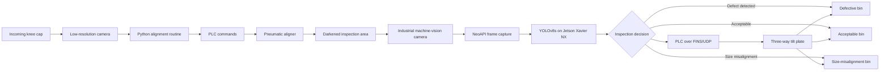

# Design and Evaluation of an Intelligent Visual Inspection System

An academic research project that investigates automated quality inspection and sorting of fabric knee caps using computer vision, deep-learning object detection, edge computing, and industrial control.

> **Project status:** Research prototype
>
> **Primary source:** [Project report](./Design%20%26%20Evaluation%20of%20an%20Intelligent%20%20Visual%20Inspection%20System%20-%20Academic%20Research%20Project%20Report%20By%20Akshit%20Narwal.pdf)

## At a glance

| Area | Reported implementation |
| --- | --- |
| Product | Fabric knee cap / elastic compression sleeve |
| Inspection objective | Detect stains, loose threads, wrinkles, and elastic irregularities |
| Vision model | YOLOv8s object detector |
| Edge computer | NVIDIA Jetson Xavier NX |
| Industrial controller | PLC connected over Ethernet using FINS over UDP |
| Cameras | Low-resolution alignment camera and industrial inspection camera |
| Image processing | Python, OpenCV, and NeoAPI camera integration |
| Sorting outputs | Defective, acceptable, or size-misaligned bin |
| Annotation tool | LabelImg with rectangular bounding boxes |
| Training setup | 100 epochs, 1024 × 1024 input, batch size 8 |

## Overview

Manual visual inspection is vulnerable to fatigue, distraction, inconsistent judgement, limited throughput, and poor capture of structured quality data. This project explores a continuous inspection pipeline in which a knee cap is aligned on a conveyor, photographed, analysed by an object-detection model, and routed to a physical collection bin according to the inspection decision.

The system is designed for a defined knee-cap variant and a controlled inspection environment. It is not presented as a general-purpose textile inspection system. Changing the product, material, lighting, or defect taxonomy would require new examples, annotation, retraining, and validation.

## System workflow

### Three operating stages

1. **Alignment** — A low-resolution front camera observes the incoming product. Python sends commands to the PLC, which operates a pneumatic aligner to position the knee cap.
2. **Inspection** — In a darkened inspection area, an industrial camera captures a higher-resolution image. YOLOv8s predicts the knee-cap and defect regions, while the inspection logic estimates product dimensions.
3. **Sorting** — The Jetson transmits the decision to the PLC. Pneumatic and stepper mechanisms operate a three-way tilt plate that routes the item to the appropriate bin.

## Product and inspection criteria

The inspected product is a fabric knee cap made from a moisture-wicking inner lining, nylon exterior, and integrated spandex threads. Its relevant visual characteristics include a knitted surface, elastic borders, a contoured patellar section, and a logo region.

The report identifies the following inspection targets:

| Label | Meaning |
| --- | --- |
| `kneecap` | Full product region |
| `logo` | Product logo or identifying feature |
| `stain` | Visible discoloration or surface mark |
| `thread` | Loose or unwanted thread |
| `wrinkle` | Fabric crease or fold affecting surface uniformity |
| `elastic` | Irregularity in the elastic edge or component |

The report also cites a target un-stretched length of **295 ± 10 mm** for the evaluated sample variant. This specification is variant-specific and should not be generalized to every knee-cap size. The prototype’s reported dimensional estimates were approximately **25–30 cm in width** and **14–16 cm in height**.

## Data collection and annotation

### Image acquisition

- A Baumer machine-vision camera was mounted approximately 1 m above the base.
- Products were placed against a black background under uniform, soft overhead lighting.
- Each knee cap was photographed from the front and back.
- Images were captured at 1080p in a controlled stationary setup.
- A Python workflow cropped irrelevant areas and organized images by defect category.

The controlled setup improved visibility and reduced irrelevant variation, but it did not fully represent the motion blur introduced by a running conveyor. That difference became an important deployment limitation.

### Dataset composition

The report describes approximately 100 unique knee caps per defect category. Augmentation included 180° rotation, scaling to 720p, and changes to clarity and contrast, producing approximately 500 image variants per category. The intended split was:

| Split | Proportion |
| --- | ---: |
| Training | 70% |
| Testing | 20% |
| Validation | 10% |

Because the report describes approximate counts and augmented variants, these figures should be treated as project documentation rather than a fully reproducible dataset manifest.

### Annotation protocol

Images were labelled manually in LabelImg with tight rectangular bounding boxes. Annotators enclosed the visible extent of each valid element in one box where practical, used the smallest practical number of boxes when necessary, and flagged uncertain boundaries for team review.

## Model and training

### Why object detection?

The defects vary in appearance:

- stains primarily change colour or local texture;
- loose threads are narrow, elongated structures;
- wrinkles alter the local fabric pattern and geometry;
- elastic problems occur near product boundaries.

Object detection is useful because the system needs both a class decision and the location of the product or defect in the image.

### YOLOv8s architecture

The report describes YOLOv8 as a single-stage, CNN-based detector with:

- a **backbone** for extracting visual features;
- a **neck** for combining features across scales; and
- an **anchor-free detection head** for predicting bounding boxes and class scores.

Its multi-scale feature processing is relevant because the model must identify the whole knee cap as well as small details such as stains and loose threads.

### Reported training configuration

| Parameter | Value |
| --- | --- |
| Model | YOLOv8s |
| Initialisation | Default weights reported in the training setup |
| Epochs | 100 |
| Input size | 1024 × 1024 pixels |
| Batch size | 8 |
| Training hardware | Dell Tower Pro workstation |
| GPU | NVIDIA RTX A4000 Ada |
| CPU / memory / storage | Intel Xeon / 128 GB RAM / 2 TB storage |
| Reported training time | Approximately 8–10 hours |

## Deployment architecture

### Edge inference

The application was deployed to an NVIDIA Jetson Xavier NX. The report describes checking CUDA availability and using JetPack 5.1.1 (revision 1) as the recovery/reflash path when the device did not boot correctly or CUDA was unavailable. The installation procedure required CUDA 11.4 or later for the stated YOLOv8 setup.

### Camera responsibilities

The cameras have deliberately separate responsibilities:

- **Front low-resolution webcam:** observes product arrival and supports alignment.
- **Industrial camera:** captures the detailed frame used for defect detection.

Industrial image capture was handled through the NeoAPI library before frames were passed to the YOLOv8 model.

### PLC communication and actuation

The Jetson communicates with the PLC over Ethernet. Python uses the FINS protocol over UDP to read device state and write mapped control bits as hexadecimal values. The PLC then controls:

- the conveyor sequence;
- the pneumatic alignment gate; and
- the pneumatic/stepper-actuated three-way tilt plate.

The software also checks the machine’s starting state. A three-colour indicator communicates status to operators: red for halted, amber for paused, and green for running. The PLC, wiring, aligner, and tilt plate were tested independently before integrated operation.

### Operator interface

A PyQt interface on the machine’s onboard screen displays the number of articles processed and information about detected defects.

## Reported results

The report presents results at two different levels. These should not be conflated:

1. **Image/model evaluation** measures detection quality on images.
2. **Machine evaluation** must additionally measure whether the correct physical item reaches the correct bin at operating speed.

### Model metrics

Approximate values read from the reported training curves were:

| Metric | Approximate value |
| --- | ---: |
| Precision | 0.60 |
| Recall | 0.57 |
| mAP@0.50 IoU | 0.61 |
| mAP@0.50–0.95 IoU | 0.45 |

The normalized confusion matrix showed stronger recognition for the knee-cap class (**0.83**) and wrinkles (**0.80**) than for some other classes. Stain, thread, and elastic examples were more frequently classified as background, indicating clear opportunities for dataset and model improvement.

### Prototype observations

- Five representative test frames localized target knee caps with confidence values between **93.74% and 98.24%**.
- In machine-area conditions, reported localization confidences included **0.81** and **0.95**.
- One capture included two distinct stain detections.
- Estimated dimensions ranged from approximately **25–30 cm width** and **14–16 cm height**.

These confidence values are detection outputs, not proof of end-to-end sorting accuracy. The report does not establish production-level false-accept, false-reject, throughput, latency, or sorting-success rates.

## Challenges and limitations

### Motion blur and domain shift

The initial training images were clear and stationary, while conveyor images contained slight motion blur. Performance dropped in the moving setup even at the same nominal resolution. The team addressed this by capturing images directly from the running conveyor and adding them to the dataset.

### Small and low-contrast defects

Loose threads, subtle stains, and elastic irregularities can occupy very few pixels or have weak contrast against the fabric. This is consistent with the weaker reported recognition of some defect classes.

### Product specificity

The model is tailored to one knee-cap style and a fixed defect vocabulary. New product variants or materials require additional data collection, annotation, retraining, and validation.

### Missing production evidence

The reported evaluation does not provide a complete end-to-end trial at a specified conveyor speed. A production assessment should separately report per-class precision, recall, mAP, item-level false accepts, false rejects, inspection time, actuator timing, and sorting success.

## Recommended next steps

1. Build a versioned dataset manifest containing source-image counts, augmentation rules, product variants, and exact train/validation/test membership.
2. Add more moving-conveyor images covering belt speed, product orientation, lighting variation, folds, and partial occlusion.
3. Report per-class confusion matrices and precision/recall in addition to aggregate metrics.
4. Calibrate the dimensional measurement against a physical reference and document camera geometry.
5. Measure end-to-end performance at declared belt speeds, including inference latency, PLC response time, actuator timing, and bin accuracy.
6. Define acceptance thresholds and log every inspection event for traceability.
7. Evaluate failure-safe behaviour for camera disconnects, PLC communication loss, low confidence, and actuator faults.

## Reproducing the documented setup

The repository currently contains the academic report, not the original training code, dataset, PLC program, or deployment package. The following is therefore a documented system outline, not a turnkey installation guide:

1. Prepare a Jetson Xavier NX with a verified CUDA/JetPack environment.
2. Connect the alignment camera, industrial camera, PLC, pneumatic aligner, and tilt plate.
3. Capture and annotate representative front/back images for every required class.
4. Train and validate a YOLOv8s model using the documented image size, batch size, and epoch count as a starting point.
5. Integrate industrial-camera capture through NeoAPI and run inference on the Jetson.
6. Map inspection outcomes to PLC memory bits and validate FINS/UDP communication safely.
7. Test each mechanical subsystem independently before conducting integrated conveyor trials.
8. Record model metrics and physical sorting metrics separately.

## Project contribution

Akshit Narwal led the data-engineering pipeline, collaborated on iterative dataset refinement, configured and trained the YOLOv8 model, implemented camera-control workflows, and integrated the AI system with the Jetson and PLC over FINS/UDP. The report acknowledges Priyansh Gupta, Tarush Arya, Sameep Rohilla, and Dr. Sushil Narang for team support, supervision, and project guidance.

## Related work and references

The report positions this prototype alongside research on fabric-defect detection and integrated vision-based sorting:

- Li, X., & Zhu, Y. (2024). [A real-time and accurate convolutional neural network for fabric defect detection](https://doi.org/10.1007/s40747-023-01317-8). *Complex & Intelligent Systems, 10*, 3371–3387.
- Yu, K., et al. (2024). [FA-YOLO: A high-precision and efficient method for fabric defect detection in textile industry](https://doi.org/10.1587/transfun.2023EAP1030). *IEICE Transactions on Fundamentals of Electronics, Communications and Computer Sciences, E107.A(6)*, 890–898.
- Teimouri, N., et al. (2018). [On-line separation and sorting of chicken portions using a robust vision-based intelligent modelling approach](https://doi.org/10.1016/j.biosystemseng.2017.12.009). *Biosystems Engineering, 167*, 8–20.
- Almtireen, N., et al. (2025). [PLC-controlled intelligent conveyor system with AI-enhanced vision for efficient waste sorting](https://doi.org/10.3390/app15031550). *Applied Sciences, 15*(3), 1550.
- Redmon, J., Divvala, S., Girshick, R., & Farhadi, A. (2016). [You Only Look Once: Unified, Real-Time Object Detection](https://doi.org/10.1109/CVPR.2016.91). *Proceedings of CVPR*, 779–788.

The full academic report, including its figures, deployment description, and cited references, is available in the repository: [open the PDF](./Design%20%26%20Evaluation%20of%20an%20Intelligent%20%20Visual%20Inspection%20System%20-%20Academic%20Research%20Project%20Report%20By%20Akshit%20Narwal.pdf).

## Acknowledgement

This README is a technical summary of the supplied academic project report. Quantities marked as approximate, reported, or observed should be verified against the original experiment logs before being used as production specifications.
