<div align="center">

# Intelligent Visual Inspection System

### AI-powered defect detection and conveyor sorting for fabric knee caps

<p>
  <a href="./Design%20%26%20Evaluation%20of%20an%20Intelligent%20%20Visual%20Inspection%20System%20-%20Academic%20Research%20Project%20Report%20By%20Akshit%20Narwal.pdf"><strong>Read the full academic report</strong></a>
  &nbsp; | &nbsp;
  <a href="#system-architecture">Explore the architecture</a>
  &nbsp; | &nbsp;
  <a href="#results-at-a-glance">View the results</a>
</p>


<br />

**See a product. Understand its condition. Make a physical decision.**

</div>

---

## The project in one picture

This project joins three worlds that are often evaluated separately:

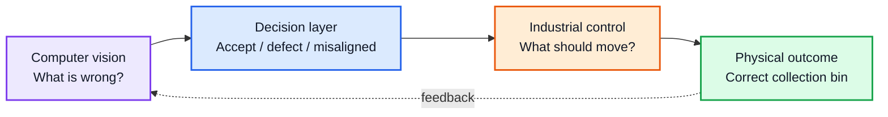

The inspected object is a fabric knee cap. The system detects visible defects, estimates product geometry, and sends a routing command to a PLC-controlled sorting mechanism. The result is a research prototype for reducing repetitive manual inspection, not a production-certified quality system.

## At a glance

<div align="center">

<table>
<tr>
<td align="center"><h2>4</h2><sub>target defect classes</sub></td>
<td align="center"><h2>2</h2><sub>camera roles</sub></td>
<td align="center"><h2>3</h2><sub>physical output routes</sub></td>
<td align="center"><h2>100</h2><sub>training epochs</sub></td>
<td align="center"><h2>8-10 h</h2><sub>reported training time</sub></td>
</tr>
</table>

</div>

| Layer | Technology or component | Purpose |
| --- | --- | --- |
| Product | Fabric knee cap | Object being inspected |
| Vision | YOLOv8s | Detect the product and visual anomalies |
| Runtime | Python, OpenCV, NeoAPI | Capture, process, and interpret images |
| Edge | NVIDIA Jetson Xavier NX | Run inference close to the machine |
| Control | PLC over Ethernet using FINS/UDP | Convert decisions into machine actions |
| Mechanics | Pneumatic aligner and three-way tilt plate | Position and sort products |
| Interface | PyQt | Display counts and detected defects |

## Why this problem matters

Manual inspection is useful, but repetitive inspection at production speed creates four connected risks:

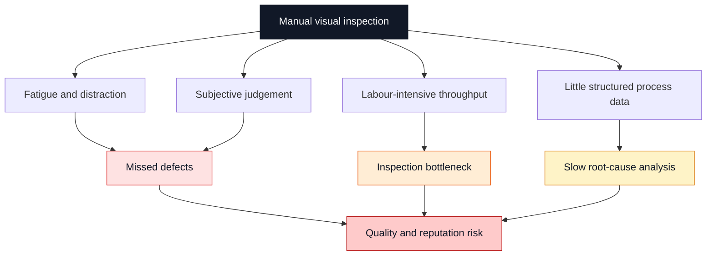

The proposed system addresses the loop with repeatable image capture, model-based decisions, machine-readable logs, and automated segregation.

## System architecture

```mermaid
flowchart LR
    subgraph ALIGN[1. ALIGNMENT]
        A[Incoming knee cap] --> B[Low-resolution camera]
        B --> C[Python alignment routine]
        C --> D[PLC command]
        D --> E[Pneumatic aligner]
    end

    subgraph INSPECT[2. INSPECTION]
        E --> F[Darkened inspection area]
        F --> G[Industrial machine-vision camera]
        G --> H[NeoAPI frame capture]
        H --> I[YOLOv8s inference\non Jetson Xavier NX]
        I --> J[Defect and size decision]
    end

    subgraph SORT[SORTING]
        J --> K[FINS/UDP message]
        K --> L[PLC memory bits]
        L --> M[Three-way tilt plate]
        M --> N[Acceptable bin]
        M --> O[Defective bin]
        M --> P[Size-misaligned bin]
    end

    style ALIGN fill:#eff6ff,stroke:#2563eb,stroke-width:2px
    style INSPECT fill:#f5f3ff,stroke:#7c3aed,stroke-width:2px
    style SORT fill:#fff7ed,stroke:#ea580c,stroke-width:2px
```

### The control relationship

The important design choice is separation of responsibilities:

| Component | Sees or controls | Why it exists |
| --- | --- | --- |
| Front camera | Product arrival and position | Alignment does not require the highest-resolution image |
| Industrial camera | Surface defects and product geometry | Inspection needs detailed, consistent imagery |
| Jetson | Inference and high-level decision | Keeps vision processing at the edge |
| PLC | Conveyor, aligner, and tilt plate | Provides deterministic industrial actuation |
| FINS/UDP link | Decision-to-action bridge | Connects Python predictions to PLC memory bits |

## What the model looks for

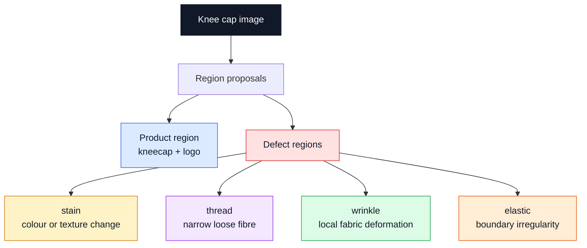

The report lists six annotation labels:

| Label | Interpretation |
| --- | --- |
| `kneecap` | Full product region |
| `logo` | Product feature or logo region |
| `stain` | Visible discoloration or surface mark |
| `thread` | Loose or unwanted thread |
| `wrinkle` | Crease or fold disturbing the knit pattern |
| `elastic` | Irregularity near the elastic edge or component |

The product drawing cited in the report specifies an un-stretched length of **295 +/- 10 mm** for the evaluated sample variant. That tolerance is variant-specific, not a universal specification for all knee caps.

## Data story: from controlled images to moving products

### Collection setup

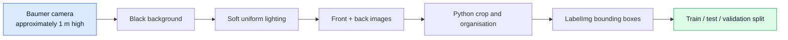

### Dataset composition reported in the document

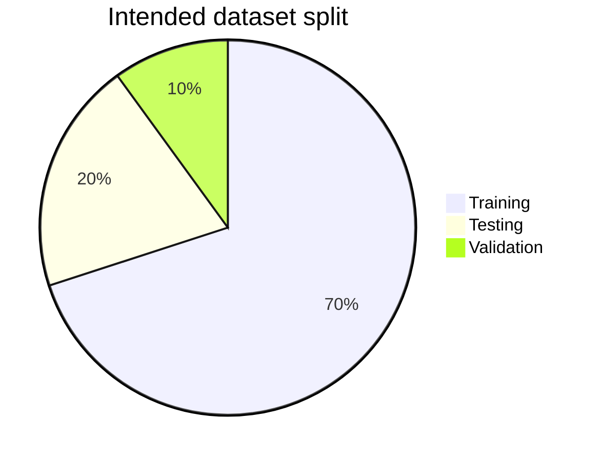

The report describes approximately 100 unique knee caps per defect category and approximately 500 augmented variants per category after rotation, scaling, clarity, and contrast changes. Images were originally captured at 1080p. The counts are approximate because the repository does not contain the dataset manifest or source images.

### The deployment gap

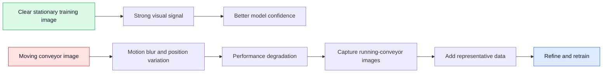

This domain shift was one of the central engineering lessons: matching nominal resolution is not enough when the image formation process changes.

## Model design and training

YOLOv8 is described in the report as a single-stage CNN detector:

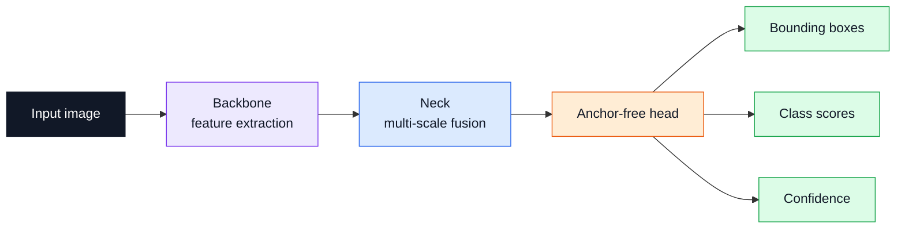

| Training parameter | Reported value |
| --- | --- |
| Model | YOLOv8s |
| Epochs | 100 |
| Input size | 1024 x 1024 pixels |
| Batch size | 8 |
| Initialisation | Default weights |
| GPU | NVIDIA RTX A4000 Ada |
| Workstation memory | 128 GB RAM |
| Reported training duration | Approximately 8-10 hours |

## Results at a glance

The report presents moderate overall detection metrics alongside strong localization examples. These are useful signals, but they are not the same as production sorting accuracy.

### Reported training/evaluation values

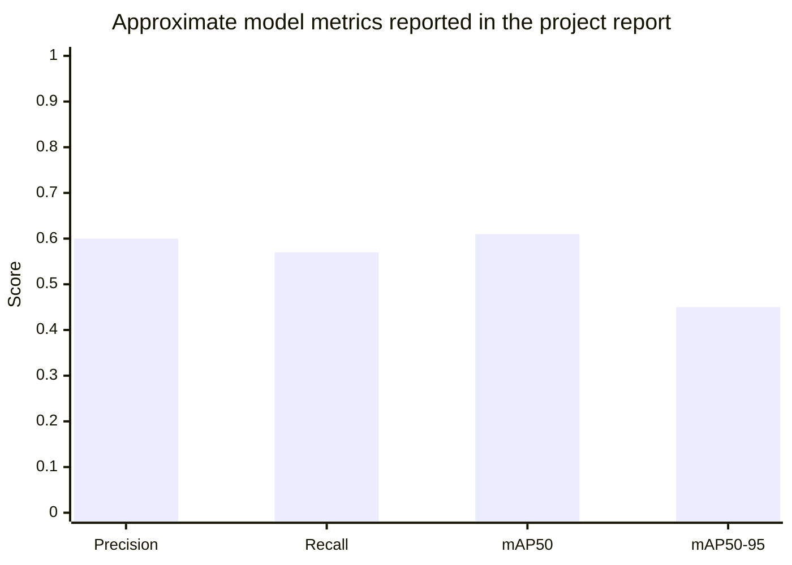

| Metric | Approximate value | What it tells us |
| --- | ---: | --- |
| Precision | 0.60 | How often predicted detections were correct |
| Recall | 0.57 | How many relevant defects were found |
| mAP@0.50 IoU | 0.61 | Detection quality at a looser overlap threshold |
| mAP@0.50-0.95 IoU | 0.45 | Stricter localization quality across thresholds |

### Class-level signal

The normalized confusion matrix in the report showed stronger recognition for:

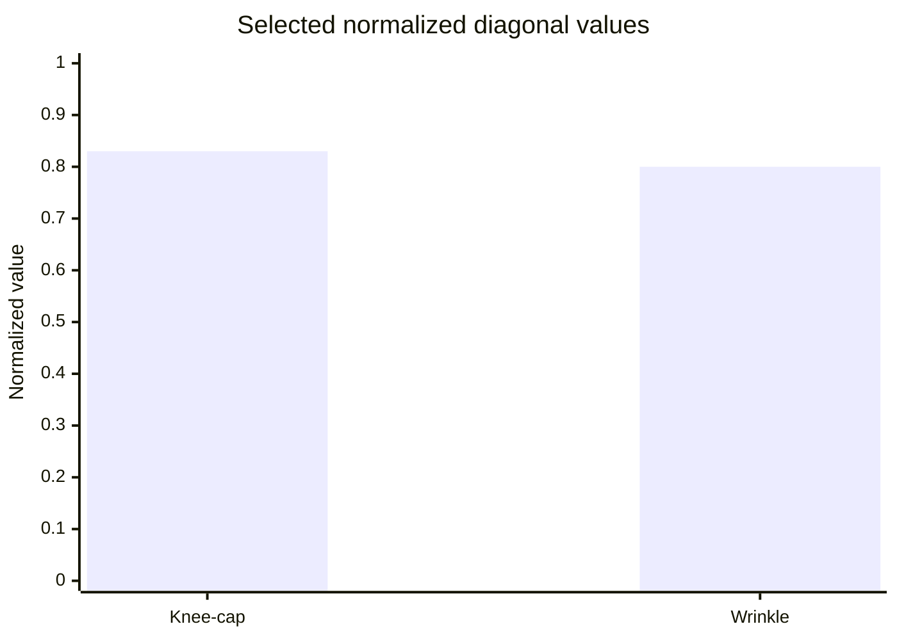

Stain, thread, and elastic instances were more often classified as background. That pattern points directly to the next work: more representative samples, stronger small-defect coverage, and evaluation by class rather than only by aggregate score.

### Prototype observations

<div align="center">

| Observation | Reported evidence |
| --- | --- |
| Test-frame localization | 93.74% to 98.24% confidence across five representative frames |
| Machine-area detections | Confidence values including 0.81 and 0.95 |
| Defect example | Two stain instances isolated in one capture |
| Estimated geometry | Approximately 25-30 cm width and 14-16 cm height |

</div>

> **Interpretation guardrail:** confidence is a model output. It does not establish false-accept rate, false-reject rate, conveyor throughput, actuator timing, or end-to-end bin accuracy.

## The engineering boundary: AI decision versus physical result

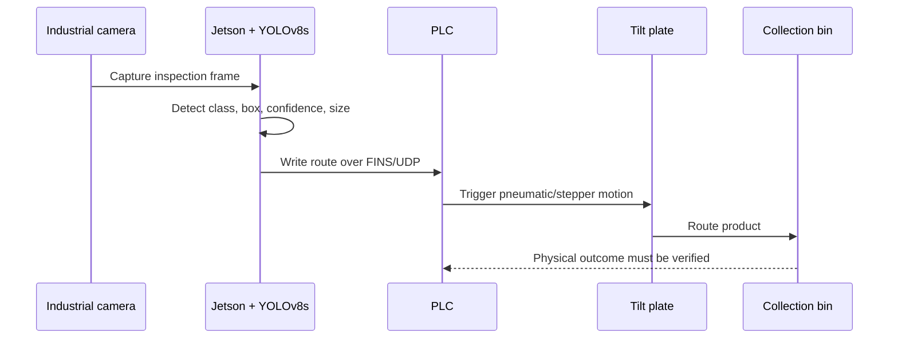

The model can be correct while the machine is wrong: a late command, communication failure, poor alignment, or actuator timing error can still send an item to the wrong bin. A credible production evaluation must therefore report both model metrics and machine metrics.

## Limitations and risk map

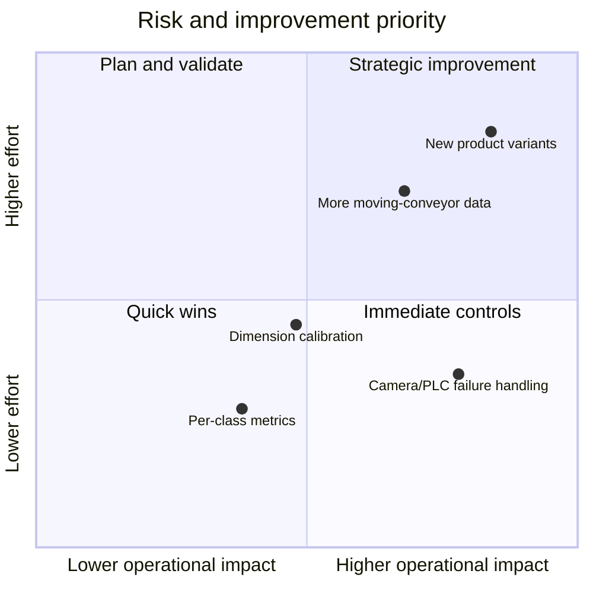

| Limitation | Consequence | Practical response |
| --- | --- | --- |
| Motion blur | Lower performance during conveyor operation | Capture representative moving data and tune exposure/lighting |
| Small or low-contrast defects | Stains, threads, and elastic defects can become background | Increase class coverage, resolution, and targeted augmentation |
| Product-specific model | New styles and materials require retraining | Maintain a versioned dataset and validation protocol |
| No full production trial reported | Sorting reliability is not established | Measure latency, belt speed, routing accuracy, false accepts, and false rejects |
| Hardware/control dependency | Correct AI output can still produce wrong physical routing | Add health checks, timeouts, safe states, and event logs |

## What is in this repository?

At present, the repository contains the academic report and this technical landing page. It does **not** contain the original training code, dataset, PLC program, or deployment package.

```text
.
|-- README.md
`-- Design & Evaluation of an Intelligent  Visual Inspection System - Academic Research Project Report By Akshit Narwal.pdf
```

The README is intentionally an evidence-backed project overview, not a claim that the complete machine can be rebuilt from this repository alone.

## Reproduction outline

1. Prepare a Jetson Xavier NX with a verified CUDA/JetPack environment.
2. Connect the alignment camera, industrial camera, PLC, pneumatic aligner, and tilt plate.
3. Capture front/back images for every target class under both controlled and moving conditions.
4. Annotate tight bounding boxes in LabelImg and preserve an exact dataset manifest.
5. Train and validate YOLOv8s using the documented configuration as a starting point.
6. Integrate industrial capture through NeoAPI and run inference on the Jetson.
7. Map decisions to PLC memory bits and validate FINS/UDP communication safely.
8. Test every mechanical subsystem independently before integrated conveyor trials.
9. Report image-level detection and item-level sorting metrics separately.

## Recommended next experiments


## People, authorship and acknowledgements

This project was completed as part of the **AIP252: Co-op Project at Industry - Module II** in the BE-CSE (Artificial Intelligence) programme at Chitkara University Institute of Engineering & Technology.

### Author contribution

| Contributor | Role documented in the report |
| --- | --- |
| **Akshit Narwal** | Primary researcher and developer; led the data-engineering pipeline, iterative dataset refinement, YOLOv8 configuration and training, camera-control workflows, and Jetson-to-PLC integration. |
| **Priyansh Gupta** | Project team member who contributed through collaboration, technical support, and shared project execution. |
| **Tarush Arya** | Project team member who contributed through collaboration, technical support, and shared project execution. |
| **Sameep Rohilla** | Project team member who contributed through collaboration, technical support, and shared project execution. |

The report identifies Akshit Narwal as the primary researcher and developer. It does not provide a task-by-task breakdown for the other student contributors, so their roles are described conservatively as team collaboration and support rather than assigned technical responsibilities that are not documented.

### With special respect and gratitude

The project also recognises the senior academic and research leadership that made the work possible:

<div align="center">

| Academic leadership | Contribution and recognition |
| --- | --- |
| **Dr. Sushil Narang**<br /><sub>Dean, CSE-AI<br />Project Supervisor</sub> | Provided supervision, guidance, encouragement, and academic direction throughout the project. His mentorship helped shape the system design, evaluation approach, and completion of the report. |
| **Dr. P.K. Khosla**<br /><sub>Pro Vice-Chancellor - Research</sub> | Recognised in the project report as part of the senior research leadership associated with the project context and its institutional support. |

</div>

> **Acknowledgement:** The team expresses its sincere respect and gratitude to Dr. Sushil Narang for his valuable supervision and to Dr. P.K. Khosla for his senior research leadership. Their guidance and institutional support gave the student team the opportunity to convert an academic idea into an integrated vision, edge-computing, and industrial-control prototype.

The report states that the project was recognised at the **Global AI Summit & National Awards, New Delhi, 2025**.

## References

- Li, X., & Zhu, Y. (2024). [A real-time and accurate convolutional neural network for fabric defect detection](https://doi.org/10.1007/s40747-023-01317-8). *Complex & Intelligent Systems, 10*, 3371-3387.
- Yu, K., et al. (2024). [FA-YOLO: A high-precision and efficient method for fabric defect detection in textile industry](https://doi.org/10.1587/transfun.2023EAP1030). *IEICE Transactions on Fundamentals of Electronics and Communications in Computer Sciences, E107.A(6)*, 890-898.
- Teimouri, N., et al. (2018). [On-line separation and sorting of chicken portions using a robust vision-based intelligent modelling approach](https://doi.org/10.1016/j.biosystemseng.2017.12.009). *Biosystems Engineering, 167*, 8-20.
- Almtireen, N., et al. (2025). [PLC-controlled intelligent conveyor system with AI-enhanced vision for efficient waste sorting](https://doi.org/10.3390/app15031550). *Applied Sciences, 15*(3), 1550.
- Redmon, J., Divvala, S., Girshick, R., & Farhadi, A. (2016). [You Only Look Once: Unified, Real-Time Object Detection](https://doi.org/10.1109/CVPR.2016.91). *Proceedings of CVPR*, 779-788.

<div align="center">

### Primary source

[Open the complete project report](./Design%20%26%20Evaluation%20of%20an%20Intelligent%20%20Visual%20Inspection%20System%20-%20Academic%20Research%20Project%20Report%20By%20Akshit%20Narwal.pdf)

<sub>README prepared from the supplied academic report. Approximate or observed values should be verified against original experiment logs before use as production specifications.</sub>

</div>
